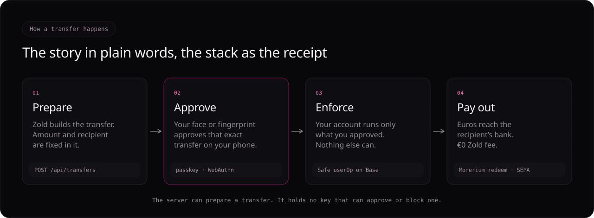
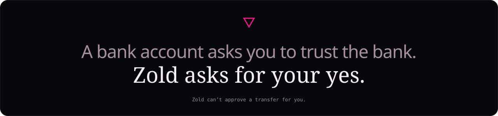
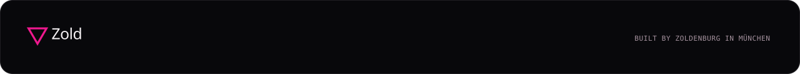

<p align="center">
  <a href="https://zoldhq.com"></a>
</p>

<p align="center">
  <a href="https://zoldhq.com"><b>zoldhq.com</b></a> &nbsp;·&nbsp;
  <a href="https://github.com/Zoldenburg-me/zold-docs"><b>User docs</b></a> &nbsp;·&nbsp;
  <a href="SECURITY.md"><b>Security</b></a> &nbsp;·&nbsp;
  <a href="https://github.com/Zoldenburg-me"><b>Built by Zoldenburg</b></a>
</p>

<br>

# Zold

**Nothing moves without your yes.** Zold is the euro account you own, for
people and businesses whose money crosses borders. A person approves each of
their own transfers, and nobody else can: not a scammer, not an app employee,
not Zold. In a company, no one person can say yes alone.

<p align="center">
  
</p>

- **For a person: only you can send it.** Every transfer waits for your face
  or fingerprint, for that exact amount and recipient. Zold can't approve one.
- **For a company: no one person can empty the account.** A payer prepares, a
  second person approves, the bookkeeper sorts but can't send, and the
  accountant gets the books, not the keys.
- **For everyone: no rate, no asterisk.** Zold doesn't lend your euros out, so
  it pays no interest on them. They are e-money, backed one-for-one, in your
  name. Opening an account and bank transfers are free, and any fee is shown
  before you approve.

### Who else has a role

The promise covers transfers. Two other parties can act on an account, and we
name them:

- **Zoldenburg recovery, if you turn it on.** It can move your account to a new
  phone after checking that it's you. It can never send money, and your old
  phone can cancel during the waiting period.
- **Monerium**, which issues your euros, can freeze them where the law
  requires.

Card taps on the Gnosis Pay card don't ask for your face or fingerprint. The
card has its own account, and the "only you" promise does not extend to it.

**Yours, even without us, on one condition.** Add a backup key you keep
yourself, such as a hardware wallet, and you can reach your money with free,
open tools even if Zold is gone. Without one, your face or fingerprint login
works only on zoldhq.com.

<br>

## The stack is the receipt

<p align="center">
  
</p>

The IBAN comes from Monerium. Bank transfers arrive as EURe (Monerium's
regulated euro e-money token) in a Safe smart account on Base. A passkey on
your device, which is what Face ID or fingerprint unlocks, is that Safe's only
owner. Every payment is a user operation you sign at send time; the server can
prepare a debit but holds no key that can make or block one.

Anything a user reads tells that story in plain words (approve, your account,
your face or fingerprint, euros). Passkey, Safe, EURe, chain and gas stay in
this README, the developer docs, the legal notes and the user docs' "How Zold
works" page. The word list is in
[design/ui-v2/RULES.md](design/ui-v2/RULES.md#5-words-plain-language).

Product documentation for users lives in the
[zold-docs](https://github.com/Zoldenburg-me/zold-docs) repository.

<p align="center">
  
</p>

## Status

| | |
|---|---|
| **Open** | Euro IBAN (Monerium OAuth or your own Monerium API keys), SEPA payouts via Monerium redeem (no Zold fee), USDC ⇄ EURe conversion, payment page, payment links, Invoice-Me links, receipts, verifiable documents, business organisations with four-eyes drafts, invoicing, bookkeeping, Gnosis Pay card view |
| **Closed** | Cash pickup (Bridge.xyz → Stellar → MoneyGram). Quotes answer `503 RAIL_CLOSED` until `BRIDGE_LIVE=1` and an anchor are configured |
| **Not built** | USD account, other currencies, own card, Shopify in-checkout payment method |
| **Never run on real money** | No live Bridge/CCTP transfer, no registered Monerium production OAuth app, no Shopify app install, no Candide recovery call, no mail transport (mail runs on zoldhq.com only) |

app.zoldhq.com runs Base mainnet (8453) with real money, for the owner only,
behind Cloudflare Access. Two full SEPA rounds have run on it, euros in by
bank transfer and back out by bank transfer, over €2,000 in total.
zoldhq.com runs Base Sepolia (84532) with Monerium's sandbox (its
`/api/health` reports `chainId` 84532, `realMoney` false). What has and has
not run is in [docs/status.md](docs/status.md).

## Architecture

```
                      ┌──────────── browser ────────────┐
                      │ /app  /business  /pay  /r  /v   │  passkey (WebAuthn)
                      └───────────────┬─────────────────┘  signs every userOp
                                      │ HTTPS
┌─────────────────────────────────────▼──────────────────────────────────────┐
│ server.ts  wiring + authentication                                          │
│   http/        origin policy, rate buckets, sessions, guards                │
│   routes/      one router factory per subject, handed requireUserSession    │
├────────────────────────────────────────────────────────────────────────────┤
│ transfers/build.ts   the ONE path that creates a transfer                   │
│ orchestrator.ts      transfer state machine, compensation, sweeps           │
│ fx.ts  rates.ts      quotes, bound to an independent live mid               │
│ liquidity.ts         venue seam → liquidity/{lifi,rfq,uniswap,cow,best,…}  │
│ domain/              orgs, roles, plans, drafts, invoices, ledger (no I/O)  │
│ store.ts             the only code that touches the database               │
├────────────────────────────────────────────────────────────────────────────┤
│ wallet/     Candide Safe (ERC-4337, bundler + paymaster)                    │
│ adapters/   Monerium, Gnosis Pay, MoneyGram, crypto deposits, forwarder     │
│ bridge/  stellar/  shopify/  recovery/                                      │
└──────┬──────────────────┬──────────────────┬───────────────────┬───────────┘
       ▼                  ▼                  ▼                   ▼
   Base (Safe,        Monerium          FX venues           Bridge.xyz /
   EURe, USDC)     (IBAN, redeem)    (LI.FI, Bebop, …)   Stellar (closed)
```

### How a SEPA payment flows

1. `POST /api/quotes` prices the payment against a live mid (`fx.ts`,
   `rates.ts`). No rate, no quote.
2. `POST /api/transfers` calls `transfers/build.ts`, which prepares the Safe
   user operation that *is* the debit. Its token, amount and destination are
   fixed in the hash.
3. The browser signs that hash with the passkey. The chain enforces what was
   signed.
4. `orchestrator.ts` submits the userOp and redeems EURe to the IBAN through
   Monerium, recording each state and tx hash. A 4xx refusal refunds; a timeout
   or anything ambiguous goes to `MANUAL_REVIEW`.

A conversion follows the same path, with `liquidity.ts` picking the venue:
every venue's quote is checked against the independent mid, venue calldata is
allowlisted, and the amount received is measured as a balance delta.

### Directory map

```
services/api/src/
  server.ts            wiring and authentication (~350 lines)
  config.ts            every setting and every production refusal
  capabilities.ts      what /api/health tells the UI it may offer
  orchestrator.ts      transfer state machine and compensation (the money path)
  fx.ts  rates.ts      quoting and live mid-rates
  liquidity.ts         venue seam; one venue per file in liquidity/
  store.ts             data access; row shapes in store/types.ts, file db in store/db.ts
  http/                policy.ts, sessions.ts, guards.ts, pending.ts
  routes/              auth, users, transfers, monerium, orgs, business/, documents,
                       payment-requests, payment-page, receipt-shares, shopify,
                       gnosis-pay, crypto-deposits, recovery-*, admin, pages
  transfers/build.ts   builds a transfer from a quote (direct send and draft execution)
  domain/              plans, roles, drafts, invoices, invoicing, jurisdictions, ledger, coa
  wallet/              Candide Safe deployment, signing, passkey Safe plan
  adapters/            monerium-*, gnosis-pay, moneygram, crypto-deposits, candide-forwarder
  bridge/  stellar/    cash rail (closed)
  shopify/  recovery/  merchant and guardian integrations
  documents.ts  receipt.ts  reconcile.ts  webauthn.ts  crypto-at-rest.ts

services/api/public/
  index.html + app/*.js       the account app (/app): classic scripts sharing one scope;
                              main.js loads last and holds everything that awaits then renders
  business.html + business/   organisation dashboard (/business): ES modules, core.js owns state
  landing, pay, pay-request, invoice, receipt, document, admin pages
  sw.js                       service worker (page code network-first)

contracts/src/        FxSwapper, AdminTimelock, MockToken (local hardhat fixtures only)
shopify-app/          Shopify app config and checkout extension
scripts/              deploy, dev chain, operations, and every test suite
docs/                 design docs, architecture, and the GitBook user guide
```

### Rules the code depends on

- **No debit without a user signature, and no Zold key on the Safe.** The
  passkey is the only owner and signs every user operation. There is no
  allowance. (Safes deployed earlier as 2-of-2 with a Zold co-signer keep
  working until their user removes it from Settings.)
- **Fail closed.** No rate, no quote; no venue, no trade; no Monerium
  connection, no SEPA send.
- **Nothing is shown as real that has not moved real money.** Closed rails are
  hidden or labelled, never simulated.
- **Three authority checks**: session (who), member and role (may they, here),
  plan capability (did the org buy it). A draft's reviewer may not be its
  drafter.
- **Nothing deletes an org, account, invoice or ledger row.** Gating is a
  read-time filter.
- **Public projections are allowlists**, redacted on the server.

Platform design: [ARCHITECTURE.md](ARCHITECTURE.md). External dependencies and their
credentials: [INTEGRATORS.md](INTEGRATORS.md).

## Run it

Node 22 or newer.

```sh
npm install
cp .env.example .env    # every variable is documented there
npm run check           # typecheck, contracts and every offline test suite
```

| | `npm run dev` | `npm run api` |
|---|---|---|
| chain | local hardhat (31337) | `TRANSF_CHAIN_ID` (default 8453) |
| database | `data/db.dev.json`, wiped every start | `data/db.json`, kept |
| passkey Safe deploy | not possible (no bundler/paymaster) | works |

Sending a payment end to end needs `npm run api` against Base Sepolia or
Base mainnet with a funded, deployed Safe. Before `npm run api` on a new chain, run
`npm run deploy` with real operator keys.

Pages: `/` landing, `/app` account, `/business` organisations,
`/pay/<handle>` payment page, `/invoice/<token>` invoice, `/r/<slug>` shared
receipt, `/v/<code>` document verification.

### Tests

`npm run check` is offline and is the one to run. `npm run check:live` adds the
Stellar testnet suites. Each suite also runs alone (`npm run fx:test`,
`npm run business:test`, …); [TESTING.md](TESTING.md) covers manual end-to-end testing.

## Names

**Zold** is the app. **Zoldenburg** is the company. The **narwhal** is the
mascot; the mark is the hollow downward triangle.

## License

[Apache-2.0](LICENSE). Security policy: [SECURITY.md](SECURITY.md).

<br>

<p align="center">
  <a href="https://zoldhq.com"></a>
</p>
